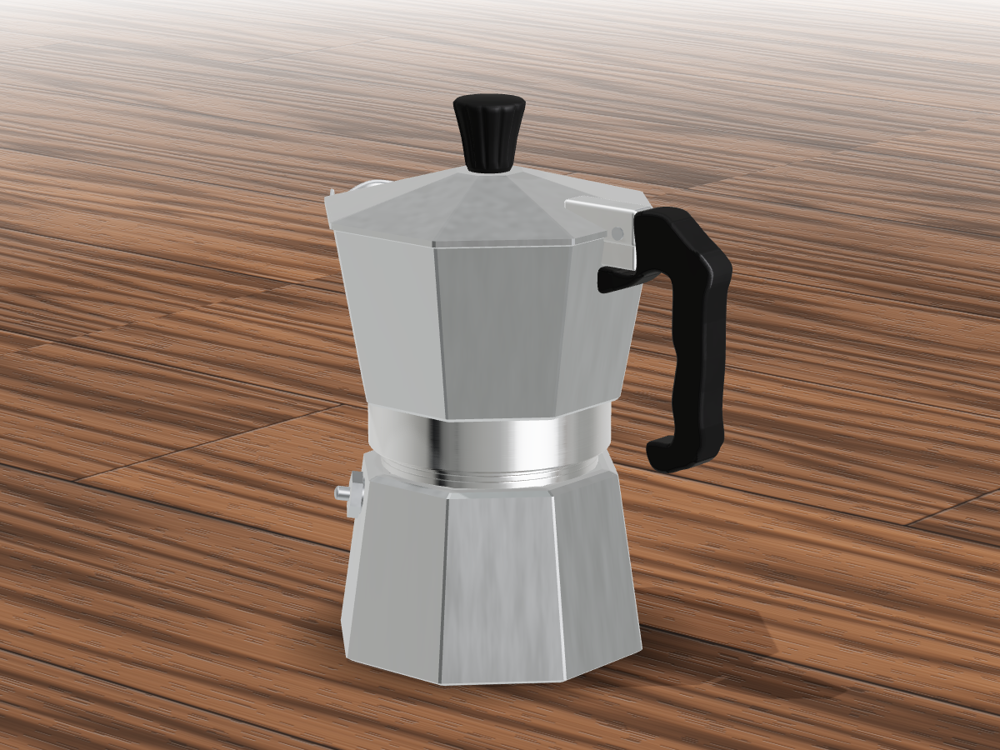
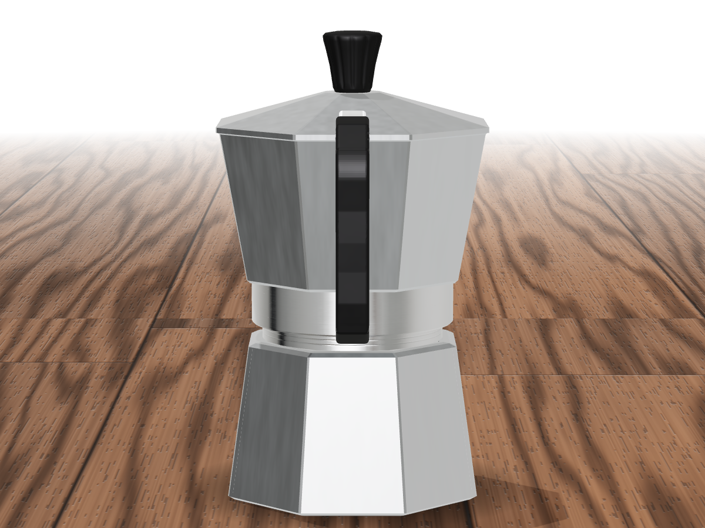
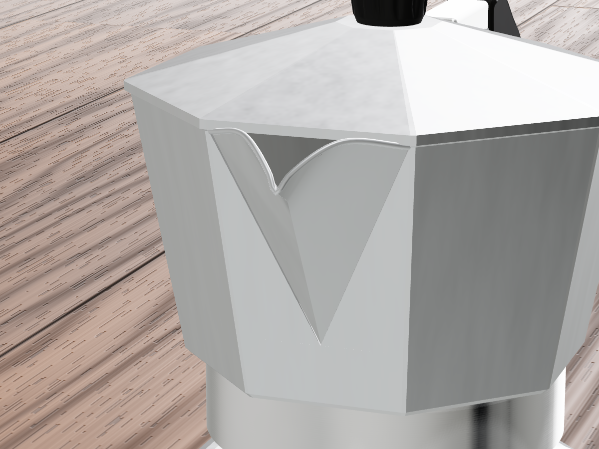
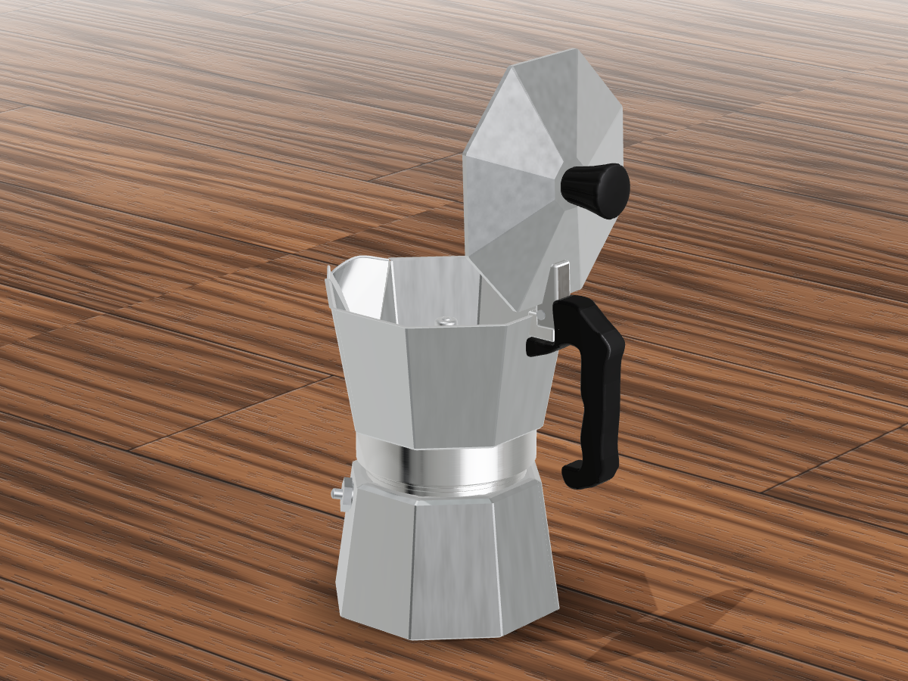
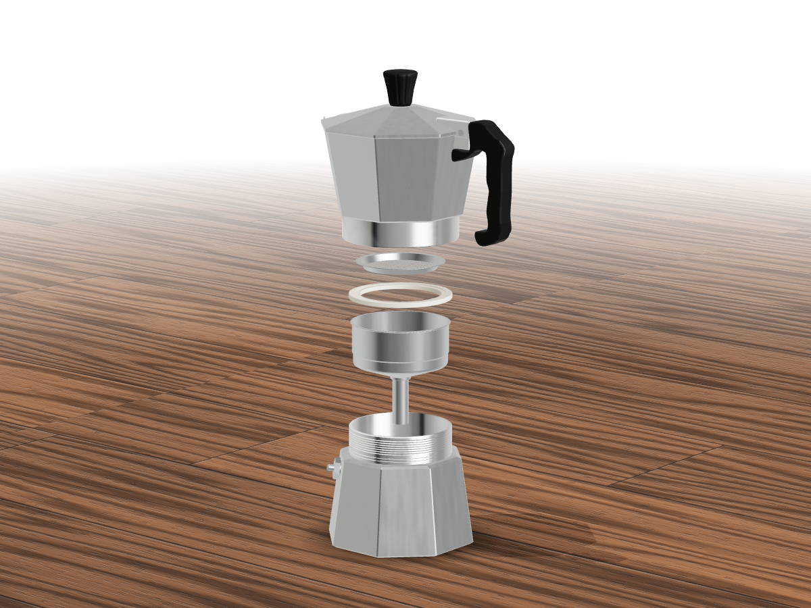

# Moka pot — procedural Three.js model

A 3-cup aluminium moka pot built entirely in code with [Three.js](https://threejs.org): no model files, no
textures except one HDRI for lighting. Every part is generated from a measured spec, with a faceted octagonal body,
swept handle, perforated funnel and filter plate, safety valve and a V pour spout.

**[Live demo](https://jakaskerjanc.github.io/moka-pot-model/)**



| | |
|---|---|
|  |  |
|  |  |

## Controls

- Drag to orbit, scroll to zoom, click a part to select it.
- `L` toggles the lid, `E` explodes the funnel, filter plate and gasket out of the pot. The upper chamber lifts off
  as one unit with the lid, hinge, knob and handle still attached.

## URL parameters

| Parameter | Effect |
|---|---|
| `view` | `front`, `three-quarter`, `side`, `rear`, `top` |
| `yaw`, `pitch`, `zoom`, `tx`, `ty` | camera angle, zoom and look-at point |
| `lid`, `explode` | `0..1` initial lid opening / explode amount |
| `solo=<partId>` | show a single part, e.g. `solo=funnel-basket`; add `flip=1` to turn it upside down |
| `table=none` | remove the wooden table |
| `bg` | background colour hex, or `transparent` |
| `envI`, `envYaw` | environment light intensity and rotation |
| `mode=clay` | one matte material, for checking the form |

## Develop

```sh
npm install
npm run dev          # http://localhost:5173
npm run build        # typecheck + production build into dist/
npm run screenshots  # regenerate docs/screenshots (needs Chromium, set CHROMIUM_PATH if not /usr/bin/chromium)
```

The model lives in `src/model/` (`mokaPotSpec.ts` holds the dimensions in millimetres, `createMokaPotModel.ts` builds
the geometry and materials), the viewer scene in `src/main.ts` and `src/scene/` (studio lighting and the procedural
wood table).

## Deploying

Pushing to `main` builds and publishes the site with the GitHub Actions workflow in `.github/workflows/pages.yml`.
Set **Settings → Pages → Source** to **GitHub Actions** once.

## Credits

Lighting uses the CC0 HDRI [White Studio 03](https://polyhaven.com/a/white_studio_03) from Poly Haven.
